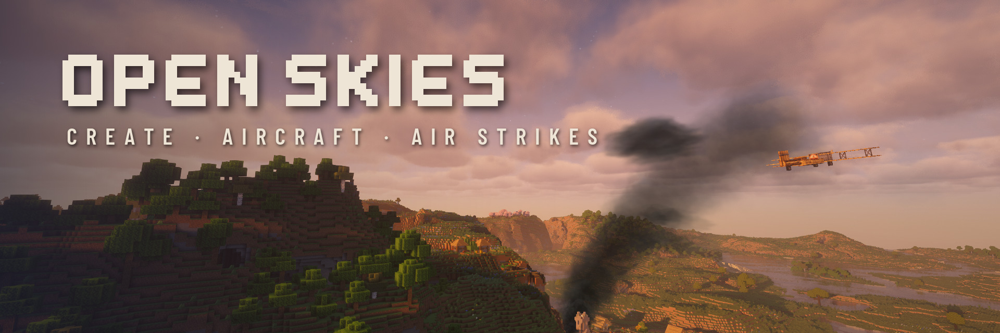
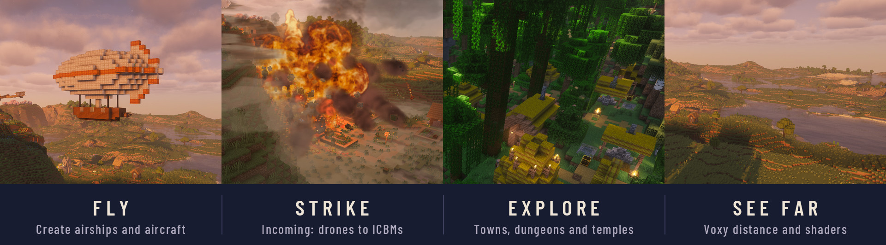
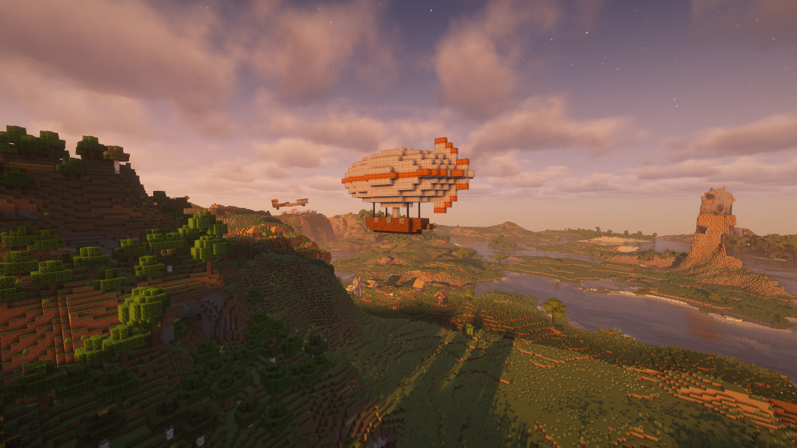
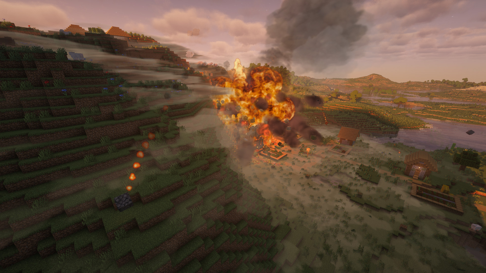
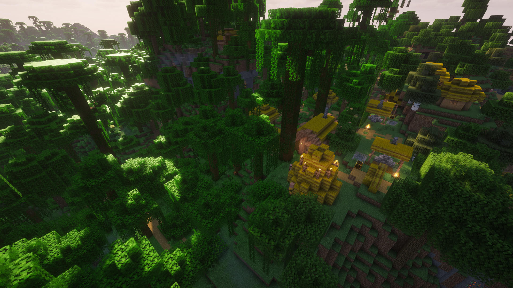

  

  <b>Build airships, explore, and defend your world from the air.</b> 
  A Create modpack for Minecraft 1.21.1 (NeoForge), built around
  <a href="https://github.com/zentixua/incoming">Incoming</a>.

  <a href="https://github.com/zentixua/open-skies/releases/latest/download/Open-Skies.mrpack"><b>⬇ Download Open-Skies.mrpack</b></a>
  &nbsp;·&nbsp; <a href="#install">How to install</a>
  &nbsp;·&nbsp; <a href="#play-with-friends">Servers</a>
  &nbsp;·&nbsp; <a href="https://github.com/zentixua/open-skies/issues">Report a problem</a>

Open Skies is a survival sandbox about a world worth defending. Settle down, build machines and airships with Create,
and fly anywhere: flight is how you travel. When you choose to fight, Incoming lets you aim through binoculars at
anything you can see and send a drone, a salvo of cruise missiles or a nuclear ICBM.

## What you can do

### Fly everywhere

Build airships from blocks with [Create Aeronautics](https://modrinth.com/mod/create-aeronautics): balloons, burners,
propellers and floating levitite, flown with real physics. [Immersive Aircraft](https://modrinth.com/mod/immersive-aircraft)
and [Man of Many Planes](https://modrinth.com/mod/man-of-many-planes) add ready-made planes, and
[Do a Barrel Roll](https://modrinth.com/mod/do-a-barrel-roll) lets you bank on elytra. There are no teleports or
waystones.

### Strike from the air with Incoming

[Incoming](https://github.com/zentixua/incoming) is the heart of the pack. Aim the Strike Designator at a target, or
pick one on its map, and send a Shahed drone, a Lancet, cruise missiles, Grad rockets or a B-2 with a bunker buster.
Blasts break blocks, shatter windows and start fires; smoke and dust drift with the wind. SAM sites shoot down drones
and missiles, and sirens warn players near a target. Nuclear strikes (an ICBM, or a nuclear warhead
on a missile or bomb) are for operators by default.

In this pack Incoming works with its neighbours: Create Aeronautics airships are targets that blasts break and push,
munition recipes use Create parts, Voxy and LOD Server Support show distant terrain on the targeting map, and the
pack's settings keep Incoming's trails, debris and sounds intact with the culling, particle and sound mods.

### Build with Create

[Create](https://modrinth.com/mod/create) 6 with Propulsion, Aeroworks and Tweaked Controllers for flying machines,
Create Big Cannons, Connected, Deco and Diesel Generators. Farmer's Delight with Create: Central Kitchen automates
cooking.

### Explore and survive

YUNG's dungeons, temples, strongholds and fortresses, and [Towns and Towers](https://modrinth.com/mod/towns-and-towers)
villages to find from the air. Lootr gives every player their own loot, Sophisticated Backpacks and Storage carry it
home, GraveStone keeps your items when you die, and Comforts adds sleeping bags for long trips. Vanilla terrain and
recipes, no quests: advancements and this page are the guide.

### See to the horizon

[Voxy](https://modrinth.com/mod/voxy) draws terrain far beyond the normal view distance. Three shaderpacks come with
the pack, none switched on: [Photon](https://modrinth.com/shader/photon-shader) (the most beautiful, the heaviest),
[Complementary Unbound](https://modrinth.com/shader/complementary-unbound) (with low-end presets) and
[MakeUp Ultra Fast](https://modrinth.com/shader/makeup-ultra-fast-shaders) (for weak PCs). Press **K** to turn shaders
on or off and **O** to choose one.

### Play with friends

Singleplayer, LAN or a dedicated server. [Open Parties and Claims](https://modrinth.com/mod/open-parties-and-claims)
protects builds and [Simple Voice Chat](https://modrinth.com/plugin/simple-voice-chat) is optional. Incoming's world
rules switch block damage and fires on or off and cap strikes per player.

## Install

1. Get a free launcher: [Modrinth App](https://modrinth.com/app) or [Prism Launcher](https://prismlauncher.org/download/).
2. Download [Open-Skies.mrpack](https://github.com/zentixua/open-skies/releases/latest/download/Open-Skies.mrpack)
   (no GitHub account needed).
3. Import it: in Modrinth App, **+** (create an instance) → "From file"; in Prism Launcher, "Add Instance" → "Import".
   ATLauncher imports it too.
4. Give the game 6 GB of memory in the instance's settings (Java and memory), then press Play.

To update, download the new release and import it the same way. Your worlds are in the old instance's `saves` folder.

**Auto-updating instance (Prism Launcher).** [Open-Skies.zip](https://github.com/zentixua/open-skies/releases/latest/download/Open-Skies.zip)
is a Prism instance that updates itself to the latest release before every launch
([packwiz-installer](https://packwiz.infra.link/tutorials/installing/packwiz-installer/)). Import it the same way;
memory is already set. Worlds and your own settings stay; files of the pack are replaced when a release changes them.

**Optional:** Simple Voice Chat. Launchers show it **unticked** when importing the `.mrpack`: tick it if your server
runs it. The auto-updating zip and a server installed with packwiz-installer get it by default.

| | Minimum | Notes |
|---|---|---|
| Java | 21 | the launcher installs it |
| Memory for the game | 6 GB | the zip sets 6144 MB |
| System RAM | 16 GB | |
| Graphics | OpenGL 4.6 (GTX 1660 / RX 580 class) | without shaders; shaders, long Voxy distances and big Create builds want more |

**Weaker PC:** keep shaders off (the default), remove `roxy-*.jar` and `voxy-*.jar` from the instance's `mods`
folder, and leave voice chat unticked; 4–5 GB of memory is then enough.

**macOS and GPUs without OpenGL 4.6:** Voxy needs OpenGL 4.6, which macOS lacks; it runs there only through
[Roxy's extra libraries](https://github.com/RasaNovum/Roxy/blob/main/Roxy-macOS-compat/setup-guide.md). Otherwise
remove both `roxy-*.jar` and `voxy-*.jar` as above. The auto-updating zip would bring them back: use the `.mrpack`.

## Play with friends

Install NeoForge (the version in [pack.toml](pack/pack.toml)) on the server, then the server side of the pack, either:
- with packwiz-installer, in the server directory
  ([bootstrap jar](https://github.com/packwiz/packwiz-installer-bootstrap/releases/latest)):
  `java -jar packwiz-installer-bootstrap.jar -g -s server https://raw.githubusercontent.com/zentixua/open-skies/main/pack/pack.toml`
  (`main` is always the latest release), or
- from the `.mrpack` with a tool that reads it, such as the
  [itzg/minecraft-server](https://docker-minecraft-server.readthedocs.io/en/latest/types-and-platforms/mod-platforms/modrinth-modpacks/)
  Docker image (`MODRINTH_MODPACK`).

Client-only mods are skipped on the server. Server notes:
- **Claims:** `/openpac-claims`, `/openpac-parties` or the `'` key in game. Whether claims also stop Incoming's strikes
  is not verified yet: test it before relying on it. Incoming's own world rules switch block damage and fire, cap
  active strikes per player and keep nuclear weapons operator-only by default
  ([Incoming's guide](https://github.com/zentixua/incoming/tree/main/docs/guide)).
- **Voice chat** needs UDP port 24454 open (`config/voicechat/voicechat-server.properties`); delete its jar on a server
  without voice chat.
- **Pre-generate** the world with [Chunky](https://modrinth.com/plugin/chunky) (`/chunky radius 3000`, `/chunky start`):
  less lag on first exploration. [LOD Server Support](https://modrinth.com/mod/lod-server-support) then sends distant
  terrain to players' Voxy and maps.
- **Performance:** [spark](https://spark.lucko.me/) (`/spark tps`, `/spark profiler`).

## Keys

The pack moves mods' default keys so that no two actions collide. A few to know: **N** projectile camera and **,**
targeting map (Incoming), **M** world map, **K** / **O** shaders, **'** claims, **Caps Lock** push to talk. Full list:
[docs/keys.md](docs/keys.md).

## What's inside

95 mods, each with one job:

| role | mods |
|---|---|
| core | [Create](https://modrinth.com/mod/create) 6.0.10, [Sable](https://modrinth.com/mod/sable) and [Create Aeronautics](https://modrinth.com/mod/create-aeronautics) (pinned: Incoming is tested against them), [Incoming](https://github.com/zentixua/incoming) (GitHub release jar) |
| Create | Propulsion: Simulated, Aeroworks, Tweaked Controllers, Create Big Cannons (+ Ritchie's Projectile Library), Create: Connected, Create Deco, Diesel Generators, Aeronautics Hot Air Fix |
| aircraft and weapons | Immersive Aircraft, Man of Many Planes, Vic's Point Blank (+ GeckoLib), Point Blank Aeronautics compat, Do a Barrel Roll (banking elytra flight, + Forgified Fabric API) |
| exploration | YUNG's Better Dungeons, Mineshafts, Strongholds, Desert Temples, Jungle Temples, Ocean Monuments, Witch Huts, Nether Fortresses and End Island, YUNG's Bridges and Extras (+ YUNG's API); Towns and Towers (+ Cristel Lib). Vanilla terrain: worlds stay cheap to generate and Voxy shows them right |
| survival | Farmer's Delight and Create: Central Kitchen (+ Create: Dragons Plus), Sophisticated Backpacks and Storage (+ Sophisticated Core), Lootr (per-player chests), Comforts (sleeping bags and hammocks for long flights), AppleSkin, GraveStone (+ its Sable patch) |
| multiplayer | Open Parties and Claims, Simple Voice Chat (optional), No Chat Reports, Chunky, spark |
| long-distance rendering | [Voxy](https://modrinth.com/mod/voxy) through [Roxy](https://modrinth.com/mod/roxy), LOD Server Support |
| performance | Sodium, Sodium Extra, Reese's Sodium Options, Lithium, FerriteCore, ModernFix, ImmediatelyFast, Entity Culling, More Culling (+ Cloth Config), Dynamic FPS, Clumps |
| look and sound | Iris (+ Colorwheel) and three shaderpacks, Euphoria Patches, Subtle Effects (+ Fzzy Config, Kotlin for Forge), Particle Rain, AmbientSounds (+ CreativeCore), Sound Physics Remastered, LambDynamicLights, Contraption Lights, Burnt (fire burns structures down), 3D Skin Layers, Not Enough Animations, Aeronautics Camera Sync |
| interface | JEI (+ MezzConfig), Jade and Jade Sable Compat, Xaero's Minimap and World Map, Create – Xaero's map, Better Advancements, Controlling (+ Searchables), Mouse Tweaks, Ok Zoomer, Default Options (+ Balm) |

**Not in the pack, on purpose:** quests and recipe changes (a sandbox), teleports and waystones (flight is the travel),
terrain overhauls (cost and Voxy), a second mod for a role already filled.

## FAQ

**Is it free?** Yes. Open Skies is not monetised.

**Forge or Fabric?** NeoForge 1.21.1 only.

**Can I add my own mods?** Yes, to your own instance. The auto-updating instance replaces only the pack's own files.

**Is it on Modrinth or CurseForge?** Not yet: download it here, from the [releases](https://github.com/zentixua/open-skies/releases).

**How often is it updated?** About once a month, plus fixes for crashes. Each release lists its changes in the
[changelog](CHANGELOG.md).

**Shaders turned themselves off.** If Voxy cannot start its renderer with a shaderpack, Voxy turns shaders off and
Iris remembers it: press K to turn them on again.

## Problems

Open an [issue](https://github.com/zentixua/open-skies/issues) with the pack version, your launcher, OS and GPU, and
the log: `logs/latest.log` from the instance folder (and `crash-reports/` if the game crashed). Try the weaker-PC
setup first if the game crashes on a weaker PC.

## For pack makers

Open Skies is built in the open with [packwiz](https://packwiz.infra.link/) and checked by CI on every change: a server
and a client install it from scratch and the client joins the server. How it is built, the settings it ships, and how
to fork it as a template for your own pack: [docs/pack-makers.md](docs/pack-makers.md).

## Licenses and credits

This repository's own files (tools, CI, configs, docs, images) are under the [MIT license](LICENSE). The pack links
every mod from its official source and bundles none: each file keeps its author's license. The pack is not monetised,
because several mods it uses (Big Cannons assets, Jade, Man of Many Planes, Towns and Towers, Cristel Lib, Entity
Culling, 3D Skin Layers and Better Advancements) allow only non-commercial use.
- **Voxy** is by MCRcortex: [modrinth.com/mod/voxy](https://modrinth.com/mod/voxy). The pack uses the official file
  `voxy-0.2.16-beta+1.21.11` from that page, unmodified. **Roxy** ([modrinth.com/mod/roxy](https://modrinth.com/mod/roxy))
  runs it on NeoForge 1.21.1: report problems with Voxy in this pack to Roxy or to us, never to Voxy.
- **Complementary Shaders** by EminGT: [complementary.dev](https://www.complementary.dev/).
- **Subtle Effects** ([modrinth.com/mod/subtle-effects](https://modrinth.com/mod/subtle-effects)) is credited here as
  its author asks; Default Options and Balm (BlayTheNinth) ask that their names stay out of a pack's title.
- The images are in-game frames from this pack (Complementary Unbound with Euphoria Patches); the icon and the
  wordmark are hand-placed pixel art in Incoming's style ([docs/media/src](docs/media/src)), the tagline font is
  Barlow Condensed (SIL Open Font License 1.1).
- Left out on purpose: shaderpacks and mods whose authors forbid redistribution or can revoke it (BSL, Flashback,
  Essential). `tools/check_sources.py` enforces this in CI.

Open Skies is not an official Minecraft product and is not approved by or associated with Mojang or Microsoft.
