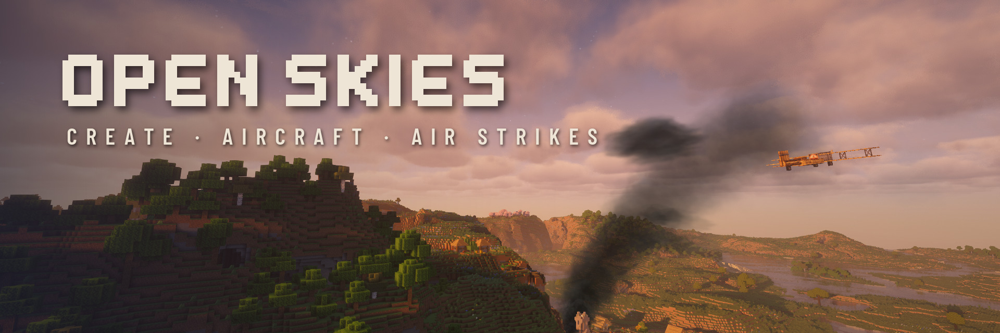
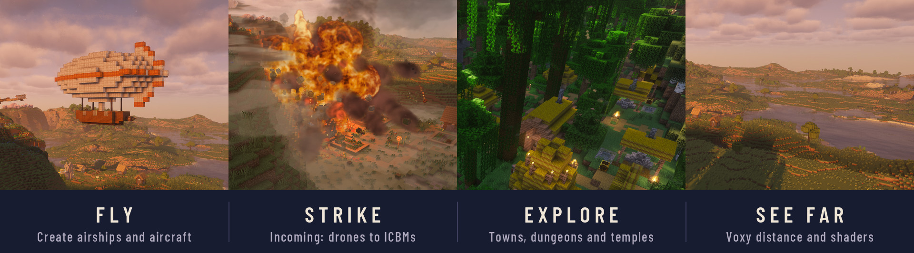
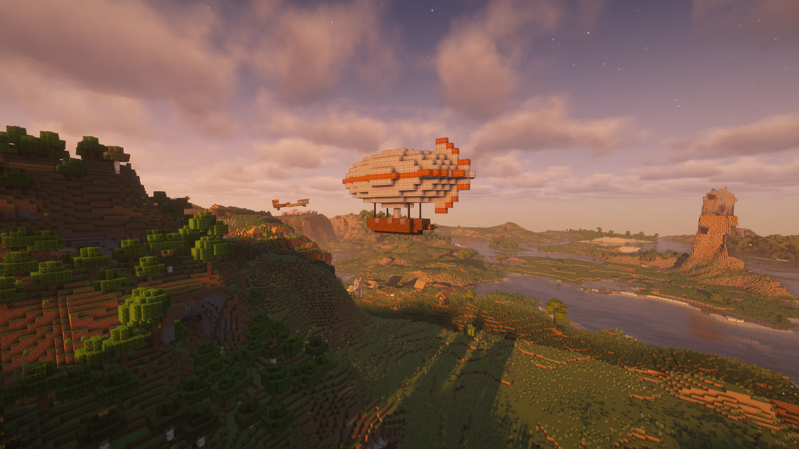
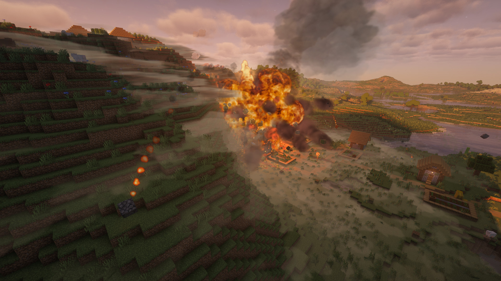
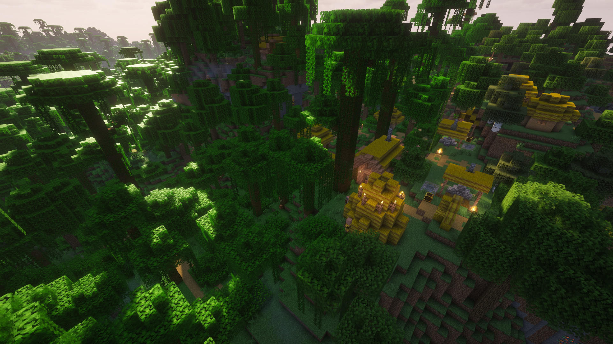

**Build airships, explore, and defend your world from the air.**

Open Skies is a survival sandbox for Minecraft 1.21.1 built around Create and [Incoming](https://github.com/zentixua/incoming).
Settle down, build machines and airships, and fly anywhere: flight is how you travel. When you choose to fight, aim
through binoculars at anything you can see and send a drone, a salvo of cruise missiles or a nuclear ICBM.

## Fly everywhere

Build airships from blocks with Create Aeronautics: balloons, burners, propellers and floating levitite, flown with
real physics. Immersive Aircraft and Man of Many Planes add ready-made planes, and Do a Barrel Roll lets you bank on
elytra. There are no teleports or waystones.

## Strike from the air with Incoming

Incoming is the heart of the pack. Aim the Strike Designator at a target, or pick one on its map, and send a Shahed
drone, a Lancet, cruise missiles, Grad rockets or a B-2 with a bunker buster. Blasts break blocks, shatter windows and
start fires; smoke and dust drift with the wind. SAM sites shoot down drones and missiles, and sirens warn players
near a target. Nuclear strikes are for operators by default.

In this pack Incoming works with its neighbours: Create Aeronautics airships are targets that blasts break and push,
munition recipes use Create parts, and Voxy and LOD Server Support show distant terrain on the targeting map.

## Build, explore, survive

- **Create 6** with Propulsion, Aeroworks and Tweaked Controllers for flying machines, Big Cannons, Connected, Deco
  and Diesel Generators; Farmer's Delight with Create: Central Kitchen.
- **Places to find from the air:** YUNG's dungeons, temples, strongholds and fortresses, Towns and Towers villages.
- **A light survival layer:** per-player loot (Lootr), backpacks and storage (Sophisticated), graves for your items,
  sleeping bags for long trips. Vanilla terrain and recipes, no quests.

## See to the horizon

Voxy draws terrain far beyond the normal view distance. Three shaderpacks come with the pack, none switched on:
Photon, Complementary Unbound and MakeUp Ultra Fast. Press **K** to turn shaders on or off and **O** to choose one.

## Play with friends

Singleplayer, LAN or a dedicated server. Open Parties and Claims protects builds and Simple Voice Chat is optional.
Incoming's world rules switch block damage and fires on or off and cap strikes per player. Server setup:
[the pack's README](https://github.com/zentixua/open-skies#play-with-friends).

## Requirements

**Minecraft 1.21.1 · NeoForge · Java 21.** Give the game 6 GB of memory; 16 GB of system RAM and a GPU with OpenGL
4.6 (GTX 1660 / RX 580 class) without shaders. Shaders, long Voxy distances and big Create builds want more.

## FAQ

**Does it run on macOS?** Voxy needs OpenGL 4.6, which macOS lacks. Remove `roxy-*.jar` and `voxy-*.jar` from the
instance's `mods` folder, or follow [Roxy's macOS guide](https://github.com/RasaNovum/Roxy/blob/main/Roxy-macOS-compat/setup-guide.md).

**My PC is weak.** Keep shaders off (the default) and remove Voxy and Roxy as above; 4–5 GB of memory is then enough.

**Can I protect my base from strikes?** The world owner can switch block damage and fires off, or limit strikes, in
[Incoming's world rules](https://github.com/zentixua/incoming/blob/main/docs/guide/settings.md#world-settings).

**Where are the keys?** The pack moves mods' keys so that none collide: [key list](https://github.com/zentixua/open-skies/blob/main/docs/keys.md).

**Are there quests?** No. Open Skies is a sandbox: advancements and this page are the guide.

## Links

[Source and full mod list](https://github.com/zentixua/open-skies) · [Issues](https://github.com/zentixua/open-skies/issues) · [Incoming's guide](https://github.com/zentixua/incoming/blob/main/docs/guide/README.md)

## License and credits

The pack's own files are under the [MIT license](https://github.com/zentixua/open-skies/blob/main/LICENSE); every mod
keeps its author's license. Not monetised. Voxy by MCRcortex ([modrinth.com/mod/voxy](https://modrinth.com/mod/voxy)),
run on NeoForge by [Roxy](https://modrinth.com/mod/roxy). Complementary Shaders by EminGT
([complementary.dev](https://www.complementary.dev/)). [Subtle Effects](https://modrinth.com/mod/subtle-effects).
Images are in-game frames from this pack.
